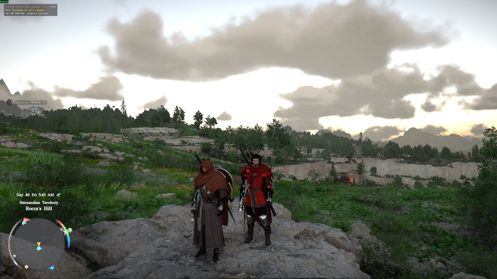

# Experimento 4c: clonar al jugador inyectando paquetes (2026-10-03)

## Resultado: ✅ funciona
- **F9** inyecta en el cliente dos `ActorLoadDataAck` con claves nuevas: usuario
  `0x9010F001`, jugador `0xA010F001` y cuerpo `0xB010F001`. **Aparece un segundo Kliff**
  en el mundo.
- **F10** inyecta dos `RemoveActorAck` (cuerpo y jugador, byte de tipo `0x15`). **El clon
  se desvanece** con la animación de desaparición del propio juego.
- Se repite sin problemas: F9 → aparece, F10 → desaparece, F9 → aparece.
- El cliente **no le quitó el control al jugador**: acepta un segundo usuario por el
  camino MMO.
- No hubo excepciones ni cierres.

Observaciones en el juego:
- el clon **tiene colisión**;
- está **congelado**: no se mueve ni tiene animación de reposo;
- lleva el equipo del momento de la carga y no cambia cuando el jugador se cambia de equipo.

## Mecánica que funcionó
- Plantillas tomadas en vivo:
  - el paquete de usuario (clave de clase `0x901` en `+0x03` y actor `0xA01` en `+0x0E`);
  - **el primer** actor de mundo (`0xB01`) que llega justo después y contiene la clave
    del jugador. Muchos NPC también la contienen; la regla se validó repitiéndola sobre
    la captura 2.
- Inyección: desde el mid-hook de `ClientNet::OnRecvPacket`, en el hilo de red del
  cliente, llamando a la propia función con nuestros bytes (bajo SEH).

## Problemas encontrados y corregidos
1. **Posición:** el clon salía donde se cargó la partida. El paquete de usuario
   (12,8 KB) también lleva la posición de mundo a 154 bytes del final, igual que el
   cuerpo. Solo se cambiaba la del cuerpo; ahora se escriben las dos. *Pendiente de
   verificar en el juego.*
2. **Plantillas contaminadas:** el sniffer también ve los paquetes inyectados y los
   tomaba como plantilla nueva. Ahora se ignoran las claves del clon.

## El cliente informa al servidor sobre el clon
Tras el spawn, el cliente envió 21 Req con las claves del clon:
- `RegionInOutReq` ×12;
- `OnDemandEquipDockingGimmickSpawnReq` ×3 (genera el equipo que lleva colgado);
- `UpdateGimmickReq` ×3;
- `MoveActorReq` ×3.

El servidor los toleró sin errores visibles, pero ahora tiene referencias a un actor
que no creó. **Regla: no guardar la partida con el clon presente.** En el cooperativo
real esos Req son justo lo que el servidor del host debe recibir para el invitado.

## Siguientes pasos
1. Verificar la posición corregida.
2. Mover el clon con los datos del ghost (`MoveActorAck` hacia el cliente, o escribir
   su transform).
3. Decidir qué hacer con los Req del clon hacia el servidor: filtrarlos mientras sea
   solo visual, o dirigirlos al servidor del host en el cooperativo real.
