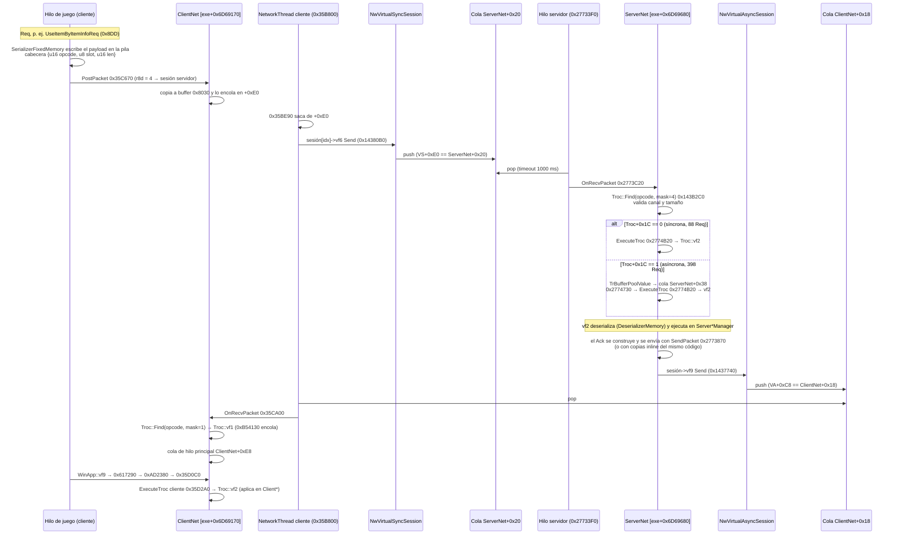

# Despacho de mensajes `pa::TrocTr*` (cliente ↔ servidor interno)

Build: **1.0.0.2976** (PE timestamp `0x6AB28F00`, base fija `0x140000000`). Todas las
direcciones son RVA (`exe+…`). Análisis estático con capstone sobre el exe en disco
(`build/research/*.py`) y comprobaciones en vivo **solo lectura** con `cdmp_probe`
(partida cargada, 2026-10-03). Nada de lo citado está en `.xtls`, salvo donde se indica.

## Resumen

1. **Los mensajes NO son objetos que viajen.** Cada clase `TrocTr*` es un **handler
   singleton estático** (objeto de 0x90 bytes en `.rdata`), registrado en una tabla hash
   por **opcode**. Lo que viaja es un **paquete de bytes** serializado campo a campo.
2. El motor es el cliente/servidor de BDO con un transporte **loopback en memoria**:
   `NwVirtualSyncSession` (cliente → servidor) y `NwVirtualAsyncSession` (servidor →
   cliente) empujan buffers a colas protegidas por lock. No hay sockets.
3. El cifrado AES-GCM de sesión existe (`CryptogramAesGcm` en `session+0x98`) pero está
   **desactivado** en las dos sesiones virtuales: los bytes van en claro.
4. Tres hilos: hilo de juego del cliente (envía Req y ejecuta Ack), `NetworkThread` del
   cliente (bombea colas) y el/los hilos del servidor (reciben Req y ejecutan).
5. Puntos de intercepción recomendados (todos en entrada de función, en `.rsrc`, firma
   única en disco y en vivo):
   - **Cliente → servidor (bytes):** `ClientNet::PostPacket` `exe+0x35C670`.
   - **Servidor → cliente (bytes):** `ClientNet::OnRecvPacket` `exe+0x35CA00`.
   - **Embudo único por transporte:** `NwVirtualSyncSession::Send` `exe+0x14380B0` y
     `NwVirtualAsyncSession::Send` `exe+0x1437740`.
   - **Nivel tipado (ya decodificado el opcode → Troc\*):** servidor `ExecuteTroc`
     `exe+0x2774B20` (todas las Req). Cliente: `exe+0x35D2A0` más `exe+0xCB4160` (este
     último para los Ack agrupados en `ScopeSenderAck`).

## Flujo de una Req y de un Ack



En texto:

```
REQ  juego ─(serializa)→ PostPacket 0x35C670 ─→ cola ClientNet+0xE0
     NetworkThread 0x35BE90 ─→ NwVirtualSyncSession::Send 0x14380B0 ─→ cola ServerNet+0x20
     hilo servidor 0x27733F0 ─→ OnRecvPacket 0x2773C20 ─→ Find(op,4) ─→ [sync | cola +0x38]
     ─→ ExecuteTroc 0x2774B20 ─→ TrocTr*Req::vf2 (deserializa y ejecuta en el servidor)

ACK  servidor ─→ SendPacket 0x2773870 (o inline) ─→ NwVirtualAsyncSession::Send 0x1437740
     ─→ cola ClientNet+0x18 ─→ NetworkThread ─→ OnRecvPacket 0x35CA00 ─→ Find(op,1)
     ─→ vf1 (encola) ─→ cola ClientNet+0xE8 ─→ hilo principal 0x35D0C0 ─→ 0x35D2A0
     ─→ TrocTr*Ack::vf2 (deserializa y aplica en el cliente)
     (ScopeSenderAck 0x7FA agrupa sub-paquetes: su vf2 0xCB45E0 → 0xCB4160 → Find(op,1) → vf2)
```

## El objeto `Troc` (handler singleton)

No existe un constructor por mensaje en tiempo de ejecución. Cada clase tiene **un**
objeto global, inicializado en constante dentro del `.rdata` del exe. Un inicializador
dinámico copia el nombre (vacío en release) y escribe la vtable. Por ejemplo
`exe+0x131110` hace `strcpy_s(obj+0x22, 0x65, "")` y luego `obj->vtbl = 0x560AFD0`.
El destructor atexit es `exe+0x5085480`. Después, funciones de registro como
`exe+0xB788D0` llaman a `TrocRegistry::Get` (`0x143B260`) y a `TrocRegistry::Insert`
(`0x143B810`) con la clave `obj+0x0C`.

| Offset | Tipo | Significado |
|---|---|---|
| +0x00 | ptr | vtable (clase concreta) |
| +0x08 | u32 | **máscara de lado**: `1` = cliente (Ack/Nak), `4` = servidor (Req), `2` = 5 Req especiales, `0x7FFFFFFE` = temporizadores del servidor |
| +0x0C | u16 | **opcode** (1002–9999). Es la clave del registro |
| +0x10 | u32 | `1` (tipo de sesión esperado; el servidor exige `==1` cuando hay sesión) |
| +0x14 | u8 | canal; debe coincidir con el byte 2 de la trama |
| +0x16 | u16 | flags: `0x200` Ack/Nak, `0x10` Req, `0xFF` temporizador, `0x4`/`0x100` casos especiales. En el cliente, sin el bit 9 el paquete se descarta |
| +0x18 / +0x1A | u16 | tamaño mínimo y máximo del paquete (con cabecera de 5); normalmente `5` y `0x7FC6` |
| +0x1C | u32 | servidor: `1` = ejecutar en diferido por la cola `ServerNet+0x38` |
| +0x21 | u8 | deshabilitado (vf2 devuelve sin hacer nada) |
| +0x22 | char[0x65] | nombre (cadena vacía en esta build) |

Registro (tabla hash): `exe+0x6A65BC8` u32 buckets (vivo: 41), `+0x6A65BCC` u32
entradas (vivo: **1115**, coincide con el número de clases), `+0x6A65BD8` array de
buckets (0x100 bytes cada uno: u32 n, pares `(u32 opcode, u32 índice)` desde +8),
`+0x6A65BE0` array de entradas (`entry+4` u16 opcode, `entry+8` Troc\*). Lo consulta
`Troc::Find` `exe+0x143B2C0`: `Troc* Find(void* reg /*ignorado*/, u16 opcode, u32 mask)`.
Devuelve el Troc solo si `troc->mask & mask`.

### vtable (3 entradas, igual en las 1.115 clases)

| Slot | Función | Qué hace |
|---|---|---|
| vf0 `+0x00` | `0xB541A0` (base `0x143B1F0`) | destructor con borrado escalar (restaura la vtable `pa::Troc` `0x5726410`) |
| vf1 `+0x08` | `0xB54130` en 2.227 vtables | **OnReceive** `(Troc*, int* res, TrocParams* p)`: añade `p->ctx` (`p+0x20`) al vector `p+0x28` (count `+0x30`, cap `+0x34`) y devuelve 0. Así el paquete queda en la cola del hilo principal. Solo lo llama el cliente. Lo sobrescriben 3 clases: `SyncSceneObjectAck` y `UnloadSyncSceneObjectAck` (`0xCB0AA0`) y `ActorLoadDataAck` (`0xCB23C0`) |
| vf2 `+0x10` | propia de cada clase | **Process** `(Troc*, int* res, TrocParams* p)`: comprueba `p->size-5 == *(u16*)(p->packet+3)` y el límite `0x7FC1`, y `this+0x21`. Construye `DeserializerMemory` (`0x5721C60`) sobre `packet+5`, lee los campos con `0x141F270` y ejecuta. Base `pa::Troc` `0x143B250` = devuelve el código de error `[0x6CDB950]` |

No hay vfunc que devuelva el opcode: es **dato** en `+0x0C`. El tipo se obtiene con
RTTI de la vtable o con la tabla `build/research/troc_table.tsv`.

`TrocParams` (lo que recibe vf2): `+0x00` actor/attacher, `+0x08` `NwSession*`,
`+0x10` u16 tamaño del paquete, `+0x18` `u8*` paquete, `+0x20` `TrBufferPoolValue*`
(contexto; null en la ruta síncrona del servidor), `+0x28` vector de diferidos,
`+0x30` count, `+0x38` u8 flag (permite paquetes de más de 0x7FC1 bytes).

### Ejemplos

| Clase | Opcode | Lado | vtable | Objeto | vf2 |
|---|---|---|---|---|---|
| `TrocTrMoveFieldAck` | 2174 `0x87E` | 1 | `0x560AFD0` | `0x6A55200` | `0xB87360` |
| `TrocTrMoveActorAck` | 2697 `0xA89` | 1 | `0x560B7F0` | `0x6A52E00` | `0xB621F0` |
| `TrocTrPrivateActorMoveAck` | 2447 `0x98F` | 1 | `0x560B750` | `0x6A52FB0` | `0xB63230` |
| `TrocTrPostProcessAttackResult_AttackTargetAck` | 2922 `0xB6A` | 1 | `0x560BB30` | `0x6A51E40` | `0xB59280` |
| `TrocTrScopeSenderAck` (contenedor) | 2042 `0x7FA` | 1 | `0x5648228` | `0x6A64C70` | `0xCB45E0` |
| `TrocTrConnectToServerAck` | 1002 `0x3EA` | 1 | `0x5647940` | `0x6A64910` | `0xCB2170` |
| `TrocTrUseItemByItemInfoReq` (diferida) | 2269 `0x8DD` | 4 | `0x5B237B8` | `0x6A77B50` | `0x2A05380` |
| `TrocTrMoveSubLevelReq` (diferida) | 2180 `0x884` | 4 | `0x5B21818` | `0x6A7F050` | `0x2A68590` |
| `TrocTrAttackByCollisionReq` (síncrona) | 2815 `0xAFF` | 4 | `0x5B220B8` | `0x6A7C620` | `0x2A3D430` |
| `TrocTrMoveFieldCompleteReq` | 2549 `0x9F5` | 4 | `0x5B24A98` | `0x6A72030` | `0x29BF120` |

Las vtables de los Ack están junto a las clases `Client*` (`0x55…–0x56…`) y las de las
Req junto a las `Server*` (`0x5B2…`).

Tabla completa (1.115 filas: opcode, máscara, flags, tamaños, vtable, objeto, vf1, vf2):
`build/research/troc_table.tsv` y `.json` (genera `troc_table.py`). Hay 525 Ack, 486
Req, 19 Nak y 85 temporizadores (`…OnceTimer` y `…RepeatTimer`). **No existe ninguna
clase con sufijo `…Noti`**: las notificaciones son `TrocTrNotify…Ack`.

## Formato en bytes: evidencia de que viajan bytes y no objetos

- **Envío del cliente**: en `exe+0xBB7E81` (dentro de `0xBB7D30`) la función crea
  `SerializerFixedMemory` (`0x5721C98`) sobre un buffer en la pila y escribe el payload
  con su vf1 `0x141F3B0`. Después monta la cabecera `{u16 0x8DD, u8 actor->vf(0x168),
  u16 payloadLen}` y llama a `PostPacket(ClientNet, &res, 4, &hdr, payloadLen+5, 0, 0x10)`.
- `PostPacket` reserva un buffer de **0x8030** bytes y hace `memcpy(buf+3, pkt, size)`.
  La longitud de la trama es `size + 0x1F`.
- **Paquete**: `u16 opcode | u8 slot | u16 payloadLen | payload`. El byte `slot` va con
  signo; el servidor resuelve el actor ejecutor con `ServerUserActor->vf(0xF8)(slot)`. Los
  temporizadores usan `0xFF`.
- **Trama de transporte**: `[u16 frameLen = len+0x1F][u8 canal][paquete][0x1C bytes]`.
  `0x1C` = 12 de IV + 16 de tag de AES-GCM. En el buffer: `+0x8000` puntero a la trama,
  `+0x8008/+0x800A` longitudes, `+0x800C` capacidad, `+0x8010` u32 índice de sesión
  (cliente), `+0x8014` u16 flags.
- **Cifrado**: `session+0x98` es un `CryptogramAesGcm` (vtable `0x570AE40`). Su vf2
  `0x12B31D0` devuelve `byte[+0x24]==1`. Valor en vivo: **0 en las dos sesiones
  virtuales**, así que el tráfico va sin cifrar.
- **Recepción**: vf2 lee con `DeserializerMemory` (`0x5721C60`) a partir de `packet+5`.
- **En vivo**: había `TrBufferPoolValue` (vtable `0x5726310`, contexto de 0x80 bytes)
  en el heap con `+0x60` = Troc\* `TrocTrUpdateBuffOnceTimer`, `+0x68` = 15 y `+0x70`
  apuntando a bytes `E6 07 FF …` (opcode 2022, slot 0xFF).

`TrBufferPoolValue` (hereda de `AsyncRequest` y `_OVERLAPPED`): `+0x30` 1, `+0x48`
`NwSession*`, `+0x54/+0x58` ids, `+0x60` `Troc*`, `+0x68` u16 tamaño, `+0x70` copia
del paquete, `+0x78` u8. Se crea con `exe+0x1439060` (65 llamadas).

## Objetos de red (verificados en vivo)

| Qué | Dónde | Campos |
|---|---|---|
| ClientNet (sin vtable) | `[exe+0x6D69170]` | `+0x10` sesión por defecto; `+0x38+i*8` sesiones (17 slots), **slot 4** (`+0x58`) = `NwVirtualSyncSession`; `+0x18` cola de entrada (desde el servidor); `+0x20/+0x28` pools; `+0xE0` cola de salida; `+0xE8` cola del hilo principal; `+0xF0` cola de reintentos; `+0x108` `ClientModuleFrameworkDesc`; `+0x118` `NetworkThread` |
| ServerNet (sin vtable) | `[exe+0x6D69680]` (distinto del `ServerActorManager` de `exe+0x6DA67D8`) | `+0x18` `NwVirtualAsyncSession`; `+0x20` cola de entrada; `+0x38` cola de Req diferidas; `+0x78/+0x80` pools (compartidos con ClientNet `+0x28/+0x20`); `+0x88` `ServerModuleFrameworkParameter`; `+0x90` `ServerModuleThreadStorage` |
| NwVirtualSyncSession (vt `0x5726248`) | ClientNet+0x58 | `+0x98` crypto; **`+0xE0` == ServerNet+0x20** (misma cola en vivo) |
| NwVirtualAsyncSession (vt `0x57260C0`) | ServerNet+0x18 | `+0x90` **`ServerUserActor`** de la sesión; `+0x98` crypto; **`+0xC8` == ClientNet+0x18** |

Las igualdades de colas se comprobaron leyendo punteros en vivo (`0x31915FFDA00` y
`0x31915FFDA80`). Prueban el loopback. Las sesiones reales por socket (`NwSyncSession`
vf6 `0x1437DA0` send y vf7 `0x1437EA0` recv, con winsock) también existen, pero no se
usan en el modo de un jugador.

Hilos:
- **Hilo principal del juego**: `WinApp::vf9` `0x3F41240` (bucle de mensajes) →
  `0x617290` → `0xAD2380` → `0x35D0C0` → `0x35D2A0` (ejecuta los Ack). `PostPacket` lo
  llaman los sistemas de juego.
- **NetworkThread del cliente**: proc `0x35B6E0`, creado en `0x35D690`. El bucle
  `0x35B800` hace el envío (`0x35BE90`) y la recepción (`0x35BB53` → `0x35CA00`).
- **Servidor**: proc `0x2773390`, cuya referencia está en `.xtls` (`0x100B5CC5`) y
  salta a `0x27733F0`. Hay otro bucle en `0x27731C0`, que procesa Req diferidas y
  temporizadores vía `0x2774730`.

## Funciones clave

| RVA | Nombre propuesto | Firma / notas |
|---|---|---|
| `0x35C670` | `ClientNet::PostPacket` | `int* (ClientNet* this, int* res, u32 sessionIdx, const u8* pkt, u16 size, u8 canal, u16 flags)`. 393 llamadas. Copia y encola; no envía |
| `0x35BE90` | `ClientNet::FlushSendQueue` | NetworkThread: saca de `+0xE0`, cifra si toca y llama a `sesión->vf6` |
| `0x14380B0` | `NwVirtualSyncSession::Send` (vf6) | `int* (VSess* this, int* res, u8* buf)` → push a `this+0xE0` |
| `0x27733F0` | bucle del hilo servidor | saca de `ServerNet+0x20` → `0x2773C20` |
| `0x2773C20` | `ServerNet::OnRecvPacket` | `int* (ServerNet* this, int* res, NwSession* s, const u8* pkt, u16 size, u8 canal)`. **Una sola llamada** (`0x27735D3`) |
| `0x2774B20` | `ExecuteTroc` (servidor) | `int* (int* res, Troc* troc, TrocParams* p)` → `troc->vf2`. 2 llamadas: síncrona `0x27742A9` y diferida `0x2774A08`. También pasan por aquí los temporizadores |
| `0x2773870` | `ServerNet::SendPacket` | `(ServerNet*, u16 op, const u8* pkt, u16 size, u8 canal, ?, vector<NwSession*>* dst)`. 509 llamadas; difunde a **N sesiones**. Hay copias inline, p. ej. `0x2961F60` |
| `0x1437740` | `NwVirtualAsyncSession::Send` (vf9) | `int* (VASess* this, int* res, AsyncRequestSend* rq)` → push de `rq+0x30` (la trama) a `this+0xC8` |
| `0x35CA00` | `ClientNet::OnRecvPacket` | `void (ClientNet* this, NwSession* s, ?, const u8* pkt, u16 size)`. Find(op,1), crea el contexto, vf1 y encola en `+0xE8` |
| `0x35D0C0` | `ClientNet::ProcessRecvQueue` | hilo principal; saca de `+0xE8` |
| `0x35D2A0` | `ClientNet::ExecuteTroc` | `int* (ClientNet*, int* res, TrBufferPoolValue* ctx, bool)` → `ctx->troc->vf2` |
| `0xCB4160` | sub-dispatch de `ScopeSenderAck` | recorre los sub-paquetes, Find(op,1) y vf2 directa |
| `0x143B2C0` | `Troc::Find` | ver arriba |
| `0x1439060` | `TrBufferPoolValue::Alloc` | `(?, u16 size)` |

## Puntos de intercepción recomendados

La regla del proyecto es usar solo inline hooks en la entrada de una función. Todas las
funciones de abajo empiezan con un prólogo normal (`mov [rsp+x],reg` / `push`) y
ninguna es destino de salto en sus primeros 5 bytes. Ninguna está en `.xtls`.

1. **Mejor punto único cliente → servidor: `ClientNet::PostPacket` `exe+0x35C670`.**
   Ve cada Req que emite el cliente local, ya serializada (`r9` = paquete, `[rsp+0x28]`
   = tamaño con cabecera). El tipo es `*(u16*)r9` → opcode, que se resuelve con
   `Troc::Find(0, op, 4)` (solo lectura) y RTTI, o con `troc_table.tsv`. `r8d` es el
   índice de sesión (4 = servidor). Corre en el hilo de quien envía: hay que copiar y
   salir rápido.
2. **Mejor punto único servidor → cliente: `ClientNet::OnRecvPacket` `exe+0x35CA00`.**
   Es el embudo de todos los bytes que llegan al cliente, antes de buscar el Troc. Corre
   en el NetworkThread. `r9` = paquete y `[rsp+0x28]` = tamaño. Ojo: el opcode `0x7FA`
   (`ScopeSenderAck`) contiene sub-paquetes y habría que desempaquetarlo.
   - Alternativa por transporte: `NwVirtualAsyncSession::Send` `exe+0x1437740`. Ahí
     acaban todas las rutas de envío del servidor, también las inline. Trama =
     `r8+0x30`; paquete = trama+3; longitud = `*(u16*)trama - 0x1F`.
   - La simétrica para cliente → servidor es `NwVirtualSyncSession::Send` `exe+0x14380B0`
     (trama = `r8`).
3. **Nivel tipado en el servidor: `ExecuteTroc` `exe+0x2774B20`.** `rdx` = `Troc*`
   (opcode en `+0x0C`, clase por RTTI de `*(void**)rdx`, lado en `+0x08`), `r8` =
   `TrocParams*` (`+0x10` tamaño, `+0x18` paquete, `+0x08` sesión). Recibe Req
   síncronas y diferidas y también temporizadores: filtrar por `troc->mask == 4`. Para
   inyectar Req de un segundo jugador en el host este nivel no basta, porque necesita
   una sesión y un `ServerUserActor` válidos (ver preguntas abiertas).
4. **Nivel tipado en el cliente:** `exe+0x35D2A0` (Ack normales, hilo principal) más
   `exe+0xCB4160` (Ack dentro de `ScopeSenderAck`).

```sigs
troc_client_post_packet | 48 89 5C 24 10 4C 89 4C 24 20 55 56 57 41 54 41 55 41 56 41 57 48 83 EC 20 45 8B E0 4C 8B F2 4C 8B E9 BD FD 01 00 | ClientNet::PostPacket entry exe+0x35C670 (cliente->servidor, bytes; r9=paquete, [rsp+0x28]=u16 tamaño, r8d=sesión) | troc-dispatch 1.0.0.2976
troc_client_on_recv_packet | 48 89 5C 24 08 48 89 74 24 10 48 89 7C 24 18 55 41 54 41 55 41 56 41 57 48 8D 6C 24 D9 48 81 EC C0 00 00 00 4D 8B F9 48 8B F2 4C 8B E9 | ClientNet::OnRecvPacket entry exe+0x35CA00 (servidor->cliente, bytes, NetworkThread) | troc-dispatch 1.0.0.2976
troc_client_execute | 48 89 5C 24 10 48 89 4C 24 08 55 56 57 41 54 41 55 41 56 41 57 48 8D 6C 24 D9 48 81 EC B0 00 00 00 45 0F B6 E1 4D 8B F8 48 8B F2 33 FF 4D | ClientNet::ExecuteTroc entry exe+0x35D2A0 (Ack -> vf2, hilo principal; r8=TrBufferPoolValue*) | troc-dispatch 1.0.0.2976
troc_client_scope_sub_dispatch | 4C 89 44 24 18 48 89 54 24 10 55 53 56 57 41 54 41 55 41 56 41 57 48 8D 6C 24 E1 48 81 EC B8 00 00 00 4C 8B EA 48 8B F9 48 89 4D C7 66 C7 45 | sub-dispatch de ScopeSenderAck exe+0xCB4160 (Ack agrupados -> vf2) | troc-dispatch 1.0.0.2976
troc_client_process_recv_queue | 48 8B C4 53 55 56 57 41 56 41 57 48 83 EC 48 C5 F8 29 70 B8 0F B6 DA 4C 8B F1 33 ED 48 89 68 18 | ClientNet::ProcessRecvQueue exe+0x35D0C0 (cola +0xE8, hilo principal) | troc-dispatch 1.0.0.2976
troc_server_on_recv_packet | 48 89 5C 24 10 4C 89 4C 24 20 48 89 4C 24 08 55 56 57 41 54 41 55 41 56 41 57 48 8D 6C 24 E9 48 81 EC B0 00 00 00 4D 8B E9 4D 8B F8 4C 8B E2 | ServerNet::OnRecvPacket entry exe+0x2773C20 (todas las Req entrantes, bytes; 1 llamada) | troc-dispatch 1.0.0.2976
troc_server_execute | 48 89 4C 24 08 53 48 83 EC 20 4C 8B CA 48 8B D9 C7 01 00 00 00 00 48 8B 02 48 8D 54 24 48 49 8B | ExecuteTroc(int*,Troc*,TrocParams*) exe+0x2774B20 (todas las Req y temporizadores -> vf2) | troc-dispatch 1.0.0.2976
troc_server_send_packet | 48 89 5C 24 20 4C 89 44 24 18 66 89 54 24 10 48 89 4C 24 08 55 56 57 41 54 41 55 41 56 41 57 48 8B EC 48 81 EC 80 00 00 00 45 0F B7 E1 | ServerNet::SendPacket exe+0x2773870 (Ack salientes; hay rutas inline que no pasan por aquí) | troc-dispatch 1.0.0.2976
troc_server_thread_loop | 48 89 5C 24 08 55 56 57 41 54 41 55 41 56 41 57 48 83 EC 40 4C 8B F9 E8 ?? ?? ?? ?? C6 84 24 88 00 00 00 01 | bucle del hilo servidor exe+0x27733F0 (pop ServerNet+0x20) | troc-dispatch 1.0.0.2976
troc_find | 40 56 45 33 C9 44 0F B7 DA 44 39 0D ?? ?? ?? ?? 41 8B F0 0F 84 ?? ?? ?? ?? 8B 0D ?? ?? ?? ?? 48 | Troc::Find(reg,u16 opcode,u32 mask) -> Troc* exe+0x143B2C0 | troc-dispatch 1.0.0.2976
troc_default_vf1_enqueue | 48 89 5C 24 08 48 89 74 24 10 57 48 83 EC 20 41 8B 48 30 49 8B F0 41 8B 40 34 48 8B FA 3B C1 77 | Troc::vf1 por defecto exe+0xB54130 (encola el contexto) | troc-dispatch 1.0.0.2976
nw_virtual_sync_session_send | 40 53 48 83 EC 20 48 8B 89 E0 00 00 00 48 8B DA 48 8D 54 24 30 4C 89 44 24 30 E8 ?? ?? ?? ?? 48 | NwVirtualSyncSession::Send (vf6) exe+0x14380B0 (todas las tramas cliente->servidor) | troc-dispatch 1.0.0.2976
nw_virtual_async_session_send | 48 89 5C 24 10 57 48 83 EC 20 48 8B 89 C8 00 00 00 49 8D 40 30 33 FF 48 8B DA 4D 85 C0 48 8D 54 | NwVirtualAsyncSession::Send (vf9) exe+0x1437740 (todas las tramas servidor->cliente) | troc-dispatch 1.0.0.2976
```

Las 13 firmas dan **1 coincidencia en disco** (`tools/scripts/aob_scan_file.py`, todas
en `.rsrc` R-X) y **13/13 en vivo** (`cdmp_probe sigs`). Copia también en
`build/research/troc_dispatch_sigs.md`.

## Preguntas abiertas

1. **Segundo jugador en el servidor del host.** `ServerNet::SendPacket` ya difunde a un
   vector de sesiones (herencia MMO) y cada sesión lleva su `ServerUserActor`
   (`session+0x90`). Falta localizar el alta de sesión (flujo
   `ConnectToServer`/`DisconnectToServer`, opcodes 1002/1004; el handler de desconexión
   está mutado en `.xtls` `0x86E5500`) para crear una segunda `NwVirtualAsyncSession`
   con su propio actor, en vez de inyectar en la sesión local.
2. **Semántica del byte `slot`** (byte 2 del paquete): sale de `actor->vf(0x168)` en el
   cliente y entra en `ServerUserActor->vf(0xF8)` en el servidor. Parece el índice del
   actor controlado (personaje, montura…). Hay que confirmarlo.
3. **Esquema de payload por mensaje**: hay que leer las llamadas a `DeserializerMemory`
   de cada vf2. Empezar por Move/MoveField/Attack/UseItem.
4. Las **5 Req con máscara 2** y las `Req` con flags `0x4`/`0x100` (rutas especiales en
   `0x2773C20`: `flags==0x100` exige `session->vf6()`).
5. **Captura real de bytes de Req/Ack**: la sonda solo lee y los buffers son
   transitorios. Haría falta un hook de registro (solo log) en `0x35C670` y `0x35CA00`
   para validar el formato con tráfico real.
6. Las rutas inline de envío del servidor (como `0x2961F60`, emisor de
   `ScopeSenderAck`) confirman que hay que interceptar en `NwVirtualAsyncSession::Send`
   o en `ClientNet::OnRecvPacket`, no en `SendPacket`.
7. La seguridad de hilos de los hooks: `0x35CA00` y las `Send` corren en hilos de red; el
   mod debe copiar el buffer y diferir el trabajo.

## Herramientas generadas (`build/research/`)

`cdpe.py` (PE, RTTI y pdata con capstone en venv), `xref.py` (índice de referencias
RIP-relativas y rel32 → `xref_index.pkl`), `vtidx.py`, `cddis.py`, `lin.py` y
`dumprange.py` (desensamblado anotado), `troc_table.py` (tabla de opcodes), `mksig.py`
(firmas mínimas únicas). Volcados: `net_1436e00.asm`, `srv_27725f0.asm`,
`cli_35cd50.asm`, `troc_base_143b240.asm`. Venv con capstone 5.0.7 en
`build/research/venv`.
