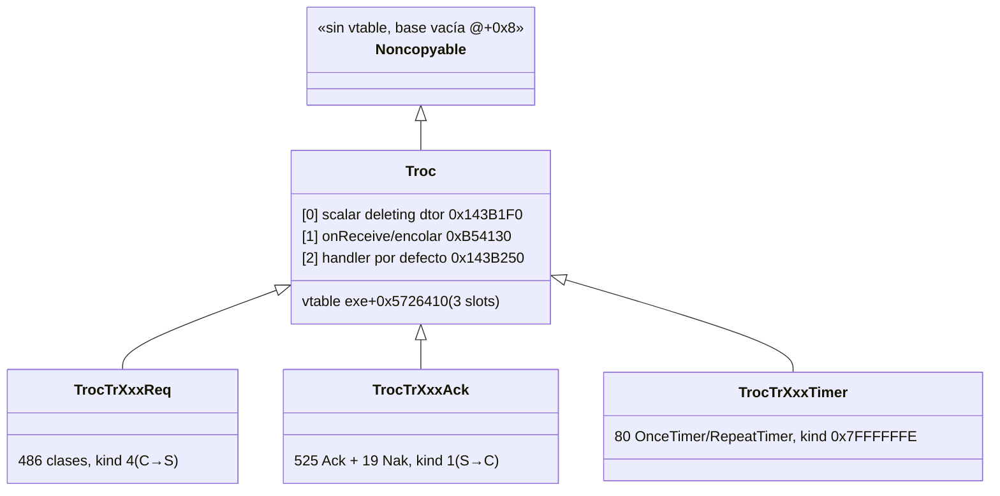
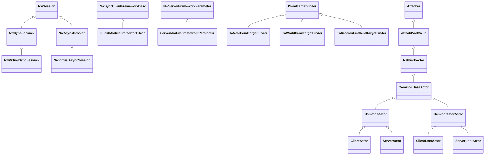
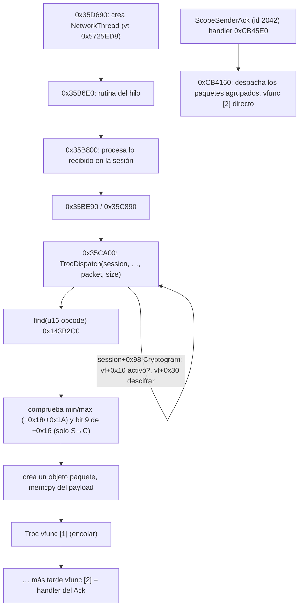

# Taxonomía RTTI de los mensajes `Troc` y su transporte

Build: CrimsonDesert.exe 1.0.0.2976 (parche 2.03.02), PE timestamp `0x6AB28F00`, base fija
`0x140000000`. Fecha: 2026-10-03. Todos los offsets son **RVA** (`exe+RVA`) y solo valen
para esta build.

Análisis **estático** del exe en disco, en solo lectura, más comprobaciones puntuales en vivo
con `cdmp_probe`, también en solo lectura. No se inyectó nada ni se tocó la carpeta del juego.

## Resumen

1. **Los mensajes no tienen jerarquía.** Las 1.115 clases `pa::TrocTr*` heredan
   **directamente** de `pa::Troc` (más la base vacía `pa::Noncopyable`). `Troc` tiene 3
   funciones virtuales y ninguna subclase añade más: `[0]` destructor, `[1]`
   recepción/encolado y `[2]` **handler**.
2. **Un `Troc` no es un paquete: es un handler.** Cada mensaje es una **instancia estática
   única** de 0x90 bytes en `.rdata`. La instancia guarda su **opcode** (`+0x0C`, de 1002 a
   9999 y único), la dirección (`+0x08`) y los tamaños mínimo y máximo del paquete
   (`+0x18`/`+0x1A`). El dato viaja en un **paquete de bytes** (`u16 opcode` + payload) y lo
   parsea el handler.
3. **Hay un registro central.** Las 1.115 instancias se registran por opcode en una tabla
   hash global en `exe+0x6A65BC8`. En vivo tiene 41 buckets y 1.115 entradas. Las altas las
   hacen 38 funciones de registro: las de Ack están en la mitad cliente del código y las de
   Req en la mitad servidor.
4. **El binario separa el código del cliente y el del servidor.** Los handlers de los `Ack`
   están en `0xB57720–0xCB45E0` (vtables en `0x5607910–0x5648228`). Los de los `Req` están en
   `0x296CAA0–0x2C3BAD0` (vtables en `0x5B21658–0x5B35210`). Es el "client module" y el
   "server module" de BDO enlazados en el mismo exe.
5. **El transporte son las sesiones `pa::Nw*Session`.** En vivo hay **una
   `NwVirtualSyncSession`** (lado cliente) y **una `NwVirtualAsyncSession`** (lado servidor),
   que apunta al `ServerUserActor` en `+0x90`. Las dos llevan un `CryptogramAesGcm` en `+0x98`.
   Un segundo jugador sería, en principio, otra `NwVirtualAsyncSession` con su propio
   `ServerUserActor`.
6. **No hay plantillas parametrizadas por mensaje** (`X<TrocTr…>`). El despacho es
   **opcode → instancia → llamada virtual**, no se hace con plantillas.

## Método

`tools/scripts/rtti_dump.py` (Python 3.14, solo stdlib) sigue estos pasos:

1. Lee las cabeceras de sección del PE y mapea RVA↔offset de fichero. Denuvo renombra las
   secciones, así que se clasifican por sus flags:

   | Sección | Permisos | Contenido |
   |---|---|---|
   | `.rsrc` | R-X | código |
   | `.xdata` | R-- | RTTI y vtables |
   | `.rdata` | RW- | datos |
   | `.xtls` | RWX | código mutado por Denuvo |
   | `.trace` | R-- | `.pdata` |
2. Busca los `TypeDescriptor` por su nombre (`.?AV…@@` / `.?AU…@@`); cada TD empieza 0x10
   bytes antes del nombre. Encuentra **15.893**.
3. Busca los `CompleteObjectLocator` en las secciones de datos. Un COL válido tiene firma 1,
   su `pTypeDescriptor` apunta a un TD conocido y cumple `pSelf == RVA propia`. Encuentra
   **15.128**.
4. Localiza cada vtable: es el qword que sigue al qword que vale `0x140000000 + RVA_COL`.
   Salen **15.128** vtables de **14.720 clases** distintas.
5. Recorre `ClassHierarchyDescriptor` → `BaseClassArray` → `BaseClassDescriptor` y guarda
   para cada base el nombre, `numContainedBases`, el PMD `{mdisp, pdisp, vdisp}` y los
   atributos.
6. Estima la longitud de cada vtable contando los qwords consecutivos que apuntan a una
   sección ejecutable. Se detiene en el siguiente puntero a COL.
7. Demangla los nombres de plantilla de forma aproximada. Quedan 106 sin demanglear (tienen
   punteros a función como argumento) y se dejan en forma mangled.

Salida: `build/research/rtti_hierarchy.json` (unos 22 MB, ~14 s).
Uso: `python tools/scripts/rtti_dump.py [exe] [-o out.json] [--filter Texto]`.

Análisis adicional, con scripts temporales que no están versionados:
- Un índice de las instrucciones `lea reg,[rip+X]` del código que apuntan a vtables e
  instancias estáticas.
- Un mapa dirección → función a partir de `.pdata` (244.444 funciones).
- El catálogo completo en `build/research/troc_messages.json` / `.csv`. Por cada mensaje:
  nombre, opcode, dirección, dominio, vtable, slot 1, handler (slot 2), instancia estática,
  tamaños mínimo y máximo, flags y función de registro.

### Verificación en vivo (cdmp_probe, juego en marcha)
- `vtables` devuelve lo mismo que el parseo estático para:

  | Clase | vtable |
  |---|---|
  | `Troc` | `0x5726410` |
  | `TrocTrMoveActorReq` | `0x5B24CF8` |
  | `NwVirtualSyncSession` | `0x5726248` |
  | `NwVirtualAsyncSession` | `0x57260C0` |
  | `NetworkThread` | `0x5725ED8` |
  | `ClientUserActor` | `0x55B59F0` |
  | `CameraManager` | `0x55CA3B8` |
  | `ClientActorManager` | `0x55B62C8` |
  | `ServerActorManager` | `0x5B25988` |
- `dump exe+0x6A6FBA0`: la instancia estática de `TrocTrMoveActorReq` tiene la vtable
  derivada, kind 4 y opcode `0x9FC` (2556), igual que en el fichero.
- `dump exe+0x6A65BC0`: el registro tiene 41 buckets y 1.115 entradas. Cada entrada ocupa
  16 bytes `{u32 ?, u32 opcode, Troc*}`. La primera es el opcode 1002 → `exe+0x6A64910`
  (`TrocTrConnectToServerAck`).
- `findptr --heap` (2 escaneos): hay exactamente **una** `NwVirtualSyncSession`
  (`0x319A41A9600`) y **una** `NwVirtualAsyncSession` (`0x319B9409F40`). Los volcados están
  en la sección 3.

## 1. Jerarquía de los mensajes



| Nivel | Clases | vfuncs propias | Notas |
|---|---|---|---|
| `pa::Noncopyable` | 1 | 0 (sin COL ni vtable) | Base vacía con `mdisp = 8`. |
| `pa::Troc` | 1 | **3** | Es la única raíz común y no tiene más bases. |
| `pa::TrocTr*` | 1.115 | **0** (todas tienen 3) | Todas sobrescriben `[0]` con el mismo destructor plegado (`0xB541A0`) y `[2]` con su handler (1.103 RVAs distintas). Solo 3 sobrescriben `[1]`. |

Recuento por sufijo y por el campo kind (`+0x08`):

| Sufijo | n | kind |
|---|---|---|
| `…Req` | 486 | 474 son kind 4 (C→S). 5 son kind **2**, dirigidos al servidor de autenticación/login: `LoginUserToAuthenticationServerReq`, `ListServerInformationReq`, `SetServerVisibilityReq`, `RefreshServerInformationTranReq` y `NotifyFamilyStateTranReq`. 7 son kind 0x7FFFFFFE, internos del servidor: `OnConnectToServerReq`, `OnDisconnectToServerReq`, `LogoutSessionToServerReq`, etc. |
| `…Ack` | 525 | 1 (S→C) |
| `…Nak` | 19 | 1 (S→C). Son respuestas de error; existe además un `TrocTrNak` genérico (opcode 1013). |
| `…OnceTimer` / `…RepeatTimer` / `…Timer` | 82 | 0x7FFFFFFE, salvo 12 `RepeatTimer` con kind 4 |
| otros | 3 | `OnceTimer_UpdateServerAIChart`, `OnceTimer_DelayCallAIEvent` y `UpdateFieldNightAndDay` (kind 0x7FFFFFFE) |

**No existe ningún mensaje `…Noti`.** Los 13 nombres que contienen "Noti" son `Notify…Ack/Req`
y `…NotNotice…`. Los **timers** también son `Troc`: son tareas diferidas del servidor y se
ejecutan con la misma maquinaria que los mensajes.

### Slots de `Troc`
Deducidos desensamblando a mano los bytes.

- **`[0]` `0x143B1F0` / `0xB541A0`: *scalar deleting destructor*.** Restaura la vtable de
  `Troc` y libera la memoria si `flags & 1`. Todos los mensajes comparten `0xB541A0` porque
  el compilador plegó los destructores idénticos (COMDAT folding).
- **`[1]` `0xB54130`: recepción/encolado.**
  - Firma: `ErrorNo f(Troc*, ErrorNo* ret, Ctx* ctx)`.
  - No usa `this`. Añade `ctx+0x20` (el objeto paquete) al vector de `ctx+0x28/+0x30/+0x34`
    (datos, tamaño, capacidad) y devuelve 0.
  - Solo lo sobrescriben tres mensajes:
    - `SyncSceneObjectAck` y `UnloadSyncSceneObjectAck`, con `0xCB0AA0`, que llama
      directamente a `this->[2]`. Es decir, se ejecutan sin encolar.
    - `ActorLoadDataAck`, con `0xCB23C0`, que salta a `.xtls` (código mutado por Denuvo).
- **`[2]`: handler.**
  - Firma: `ErrorNo f(Troc*, ErrorNo* ret, Ctx* ctx, …)`.
  - En `Troc` es un stub (`0x143B250`) que devuelve un código de error global.
  - Ejemplos: `MoveActorReq` → `0x2977E10` (servidor) y `MoveActorAck` → `0xB621F0`
    (cliente). `MoveFieldAck` → `0xB87360` tiene un frame de 0x1140 bytes y lee el paquete
    desde `[ctx+0x18]`.
- **Ningún slot serializa ni deserializa.** El handler parsea el payload directamente desde
  el buffer.

### Instancia estática de cada `Troc`
Cada instancia ocupa 0x90 bytes en `.rdata`, una detrás de otra (stride 0x90), en el rango
`exe+0x6A51AE0 … 0x6A82C80`. Su ciclo de vida:

- **En el fichero**, la instancia ya trae la vtable de `Troc` y los campos constantes.
- **Al arrancar**, un inicializador dinámico de 67 bytes (uno por mensaje; el de
  `MoveActorReq` es `0x221D20`) escribe la vtable derivada. También copia un nombre vacío con
  `strncpy_s(…, 101, "", _TRUNCATE)`.
- **Al salir**, un destructor `atexit` de 16 bytes (`0x5084E60…`) vuelve a poner la vtable
  base.

| Offset | Tipo | Significado | Valores |
|---|---|---|---|
| +0x00 | ptr | vtable | |
| +0x08 | u32 | kind (dirección) | 4 = C→S, 1 = S→C, 2 = login/auth, 0x7FFFFFFE = interno |
| +0x0C | u32 | **opcode** (en la tabla y en el paquete se usa como u16) | De 1002 a 9999, único. Los Ack van de 1002 a 3100 y los Req de 1022 a 9999. |
| +0x10 | u32 | flag | 1 en Req/Ack, 0 en timers |
| +0x14 | u32 | flags (el dispatcher prueba los bits 9 y 10 del u16 en `+0x16`) | Ack `0x02000000` (bit 9), Req `0x00100000`, timers `0x00FF0000` |
| +0x18 | u16 | tamaño **mínimo** del paquete | normalmente 5 |
| +0x1A | u16 | tamaño **máximo** | Normalmente `0x7FC6`. `ConnectToServerAck` = 11/11, `OnConnectToServerReq` = 20/20. |
| +0x1C | u32 | flag | 0/1 |
| +0x22 | char[101] | nombre (vacío en el fichero y en vivo) | |
| +0x88 | u32 | ? | 2 en Req/Ack, 0/1 en timers |

### Registro opcode → `Troc*`
- **Funciones:**
  - `0x143B260` devuelve el singleton del registro (static local thread-safe, con el guard
    en `exe+0x6EFC008`).
  - `0x143B810` es **insert**(opcode, `&instancia`).
  - `0x143B2C0` es **find**(u16 opcode, flag) → `Troc*`. Tiene una copia mutada en `.xtls`
    (`0xB8BB4D0`).
- **Tabla en `exe+0x6A65BC8`:**

  | Dirección | Contenido |
  |---|---|
  | `+0x00` | `u32` número de buckets |
  | `+0x04` | `u32` número de entradas |
  | `+0x0C` | contador de registros (cada alta lo incrementa) |
  | `+0x10` (`0x6A65BD8`) | array de buckets |
  | `+0x18` (`0x6A65BE0`) | array de entradas de 16 bytes `{u32, u32 opcode, Troc*}` |
- **38 funciones de registro.** Cada una tiene un bloque por mensaje: `call 0x143B260`, lee
  el opcode de la instancia y hace `call 0x143B810`. Algunos ejemplos (entre paréntesis, los
  mensajes que registran):

  | Lado | Función | Mensajes |
  |---|---|---|
  | Ack (cliente) | `0xB53140` | 49 |
  | Ack (cliente) | `0xB54200` | 30 |
  | Ack (cliente) | `0xB788D0` | 118 |
  | Req (servidor) | `0x2962670` | 56 |
  | Req (servidor) | `0x2997330` | 110 |

  La cadena del servidor empieza en el slot 2 de `pa::ServerModuleFrameworkParameter`
  (`0x2BB6540`, 90 mensajes), que a su vez llama a `0x2962670`. Por simetría, la del
  cliente debería colgar de `pa::ClientModuleFrameworkDesc` (vtable `0x55BEDD8`).
- **Llamadas a `find`:** hay 62 llamadas a `0x143B2C0`, casi todas en código de servidor
  (`0x27xxxxx–0x2Bxxxxx`).

## 2. Dominios (heurística por nombre)

Los mensajes se clasificaron con expresiones regulares sobre el nombre, así que la
clasificación es aproximada. El dominio de cada mensaje está en la columna `domain` de
`troc_messages.csv`.

| Dominio | Total | Req (C→S) | Ack/Nak (S→C) | Otros |
|---|---|---|---|---|
| objetos/inventario | 170 | 72 | 98 | |
| misiones/historia (Quest, Mission, Stage, Sequencer, Knowledge…) | 141 | 57 | 84 | |
| combate (Attack, Hit, Projectile, Skill, Buff, Dead/Revive…) | 127 | 64 | 62 | 1 auth |
| actor/movimiento (Move, Rotate, Spawn, SceneObject, Vehicle, Docking, Interaction…) | 122 | 65 | 57 | |
| sesión/sistema (Connect, Login, Save, Loading…) | 103 | 38 | 54 | 7 internos, 4 auth |
| IA/NPC/facción/mercenarios | 101 | 36 | 65 | |
| timers | 85 | 12 | | 73 internos |
| mundo/campo (Field, Gimmick, Weather, Zone, Housing…) | 61 | 31 | 30 | |
| cheat/dev | 51 | 42 | 9 | |
| social (Party, Guild, Chat) | 34 | 17 | 17 | |
| progresión (Experience, SubLevel, SkillPoint…) | 26 | 9 | 17 | |
| economía (Store, Market, Bank, Trade…) | 26 | 13 | 13 | |
| minijuegos | 21 | 12 | 9 | |
| crimen/se busca | 17 | 6 | 11 | |
| UI | 12 | 7 | 5 | |
| otros | 18 | 5 | 13 | |

Hay muchos restos de MMO, y varios interesan para el cooperativo:
- `OtherEquipItemAck` / `OtherUnequipItemAck` (el equipo de *otros* jugadores).
- `UpdateVisiblePlayerAck`.
- `JoinParty*` y `WorldChatting*`.
- `ToNearAndPartySendTargetFinder`.
- Las clases `Sql*` y `ServerInformationManager`.

## Tabla de mensajes relevantes para el cooperativo

`id` es el opcode. `vtable` y `handler` (slot 2) son RVAs. Los handlers de los Req corren en
el servidor y los de los Ack en el cliente. Poner un Req y un Ack en la misma fila solo
significa que se emparejaron **por el nombre**: no se ha comprobado qué Ack emite el handler
de cada Req. Un handler `0x35EA90` es un stub común que comparten miles de vtables, lo que
indica que esa lógica vive en otro sitio.

| Grupo | Req | id | vtable | handler | Ack | id | vtable | handler |
|---|---|---|---|---|---|---|---|---|
| Sesión / login | OnConnectToServerReq | 1005 | 0x5b048b0 | 0x35ea90 | ConnectToServerAck | 1002 | 0x5647940 | 0xcb2170 |
| Sesión / login | LoginCharacterToFieldServerReq | 3093 | 0x5b243f8 | 0x298ba10 | MainPlayerDataStartAck | 2756 | 0x560b430 | 0xb6eb20 |
| Sesión / login | — |  |  |  | MainPlayerDataEndAck | 2116 | 0x560b3f0 | 0xb6ef30 |
| Sesión / login | LogoutCharacterToFieldServerReq | 2564 | 0x5b243d8 | 0x298bea0 | LogoutCharacterToFieldServerAck | 2679 | 0x560b410 | 0xb6f260 |
| Sesión / login | HeartbeatReq | 1008 | 0x5b04870 | 0x35ea90 | — |  |  |  |
| Sesión / login | — |  |  |  | ScopeSenderAck | 2042 | 0x5648228 | 0xcb45e0 |
| Sesión / login | ConnectCryptogramToServerReq | 2319 | 0x5b22638 | 0x2a21670 | ConnectCryptogramToServerAck | 2840 | 0x5608ed0 | 0xbdfc10 |
| Sesión / login | LoadingCompleteReq | 2445 | 0x5b248d8 | 0x29c61a0 | LoadingCompleteAck | 2762 | 0x560adb0 | 0xb8bb00 |
| Movimiento / actor | MoveActorReq | 2556 | 0x5b24cf8 | 0x2977e10 | MoveActorAck | 2697 | 0x560b7f0 | 0xb621f0 |
| Movimiento / actor | RotateActorReq | 2828 | 0x5b24cd8 | 0x29784c0 | RotateActorAck | 2687 | 0x560b790 | 0xb62770 |
| Movimiento / actor | — |  |  |  | PrivateActorMoveAck | 2447 | 0x560b750 | 0xb63230 |
| Movimiento / actor | — |  |  |  | MoveForceAck | 2496 | 0x560b830 | 0xb619c0 |
| Movimiento / actor | EchoMoveSessionIDReq | 2624 | 0x5b24cb8 | 0x2978900 | ChangeMoveSessionIDAck | 3097 | 0x560b850 | 0xb61230 |
| Movimiento / actor | EchoActionSessionIDReq | 2350 | 0x5b25238 | 0x296e1a0 | ChangeActionSessionIDAck | 2954 | 0x560bab0 | 0xb5a860 |
| Movimiento / actor | SyncActorDataReq | 2526 | 0x5b244b8 | 0x298eb30 | SyncActorDataAck | 2455 | 0x560b250 | 0xb72320 |
| Movimiento / actor | — |  |  |  | ActorLoadDataAck | 2005 | 0x5647900 | 0xcb25a0 |
| Movimiento / actor | — |  |  |  | RemoveActorAck | 2516 | 0x560b7b0 | 0xb62c70 |
| Movimiento / actor | — |  |  |  | UpdateVisiblePlayerAck | 2135 | 0x56081f0 | 0xc06720 |
| Movimiento / actor | — |  |  |  | SyncSceneObjectAck | 2665 | 0x560aeb0 | 0xb89c40 |
| Movimiento / actor | — |  |  |  | UnloadSyncSceneObjectAck | 2517 | 0x560ae70 | 0xb8a2a0 |
| Movimiento / actor | ProcessFallReq | 2095 | 0x5b22238 | 0x2a3c4a0 | RequestFallMustFailedAck | 3045 | 0x560b870 | 0xb5f130 |
| Movimiento / actor | RideOnVehicleReq | 2589 | 0x5b219d8 | 0x2a60650 | RideOffByServerAck | 2938 | 0x560baf0 | 0xb59c20 |
| Movimiento / actor | ChangeVehiclePhysicsStateReq | 2744 | 0x5b218d8 | 0x2a6de90 | ChangeVehiclePhysicsStateAck | 2970 | 0x5607c10 | 0xc1a870 |
| Movimiento / actor | AttachDockingChildActorReq | 2287 | 0x5b24e38 | 0x296fe20 | AttachDockingChildActorAck | 2293 | 0x560b9b0 | 0xb5c9b0 |
| Campo / teleport | — |  |  |  | MoveFieldAck | 2174 | 0x560afd0 | 0xb87360 |
| Campo / teleport | MoveFieldCompleteReq | 2549 | 0x5b24a98 | 0x29bf120 | MoveFieldCompleteAck | 2144 | 0x560afb0 | 0xb87b90 |
| Campo / teleport | — |  |  |  | MoveFieldCompletePostAck | 3066 | 0x560af50 | 0xb87f60 |
| Campo / teleport | — |  |  |  | DoTeleportAck | 2987 | 0x560b810 | 0xb61640 |
| Campo / teleport | — |  |  |  | TeleportRevivePointAck | 2759 | 0x5609950 | 0xbcc190 |
| Campo / teleport | AITeleportReq | 2091 | 0x5b24f78 | 0x29841b0 | AITeleportFailAck | 2933 | 0x560b530 | 0xb6a4d0 |
| Campo / teleport | RegionInOutReq | 3067 | 0x5b24bf8 | 0x2979070 | — |  |  |  |
| Campo / teleport | SetFieldTimeReq | 2125 | 0x5b24758 | 0x29bfd70 | SetFieldTimeAck | 2816 | 0x560af30 | 0xb88990 |
| Campo / teleport | SyncWeatherStateReq | 2560 | 0x5b24818 | 0x29c5df0 | — |  |  |  |
| Combate | StartActionReq | 2223 | 0x5b251d8 | 0x296caa0 | StartActionAck | 2991 | 0x560bbf0 | 0xb57720 |
| Combate | — |  |  |  | StartSpawnActionAck | 2723 | 0x560bc10 | 0xb57bc0 |
| Combate | AttackByCollisionReq | 2815 | 0x5b220b8 | 0x2a3d430 | PostProcessAttackResult_AttackerAck | 2509 | 0x560bb90 | 0xb58f50 |
| Combate | — |  |  |  | PostProcessAttackResult_AttackTargetAck | 2922 | 0x560bb30 | 0xb59280 |
| Combate | — |  |  |  | PostProcessAttackResult_AttackTarget_SkillAck | 2846 | 0x560bb50 | 0xb595e0 |
| Combate | — |  |  |  | OnHitEventSuccessAck | 2650 | 0x560b890 | 0xb5f430 |
| Combate | CreateProjectileFromFrameEventReq | 2387 | 0x5b22158 | 0x2a3e000 | CreateProjectileAck | 2250 | 0x5608470 | 0xbf3d50 |
| Combate | OnHitProjectileReq | 2999 | 0x5b21fd8 | 0x2a3a1c0 | — |  |  |  |
| Combate | RemoveProjectileReq | 2399 | 0x5b22258 | 0x2a3bf90 | RemoveProjectileAck | 2751 | 0x5608430 | 0xbf4130 |
| Combate | — |  |  |  | VaryHPAck | 2147 | 0x560b150 | 0xb75020 |
| Combate | — |  |  |  | CharacterStatAck | 2358 | 0x560b1f0 | 0xb73d70 |
| Combate | — |  |  |  | ApplyBuffAck | 2506 | 0x5607e10 | 0xc13d70 |
| Combate | — |  |  |  | UnapplyBuffAck | 3007 | 0x5607dd0 | 0xc14140 |
| Combate | ChangeBattleStateReq | 2257 | 0x5b250b8 | 0x29814a0 | — |  |  |  |
| Combate | CatchBySummonReq | 2592 | 0x5b24dd8 | 0x2972aa0 | CatchActionResultAck | 2156 | 0x560bbd0 | 0xb582b0 |
| Combate | KillJammedTargetReq | 2392 | 0x5b23a38 | 0x29d0380 | KillJammedTargetAck | 2890 | 0x560aa50 | 0xb9c6c0 |
| Muerte / revivir | DieByRunOutFatalReq | 2321 | 0x5b24318 | 0x29947e0 | NotifyHandleDeadAck | 2530 | 0x560b0f0 | 0xb764a0 |
| Muerte / revivir | — |  |  |  | NotifyHandleFatalAck | 2899 | 0x560b090 | 0xb76900 |
| Muerte / revivir | ReviveReq | 2988 | 0x5b24498 | 0x298c070 | ReviveAck | 2475 | 0x560b3b0 | 0xb6f590 |
| Muerte / revivir | — |  |  |  | NotifyHandleReviveAck | 3053 | 0x560b0b0 | 0xb76d40 |
| Muerte / revivir | ReviveLoadingReq | 2362 | 0x5b24478 | 0x298c490 | ReviveLoadingAck | 2993 | 0x560b3d0 | 0xb6fa60 |
| NPC / IA | ChangeAIStateReq | 2734 | 0x5b25158 | 0x29820b0 | ChangeAIStateAck | 2404 | 0x560b5b0 | 0xb69700 |
| NPC / IA | — |  |  |  | ChangeAiControlAck | 2508 | 0x560b670 | 0xb681f0 |
| NPC / IA | — |  |  |  | ResetAiAck | 2649 | 0x560b590 | 0xb6a1e0 |
| NPC / IA | — |  |  |  | AiEventAck | 2218 | 0x560b5f0 | 0xb69040 |
| NPC / IA | UpdateAIDestinationReq | 2405 | 0x5b24fd8 | 0x29832a0 | — |  |  |  |
| NPC / IA | CurrentTargetChangeReq | 2984 | 0x5b25198 | 0x2980740 | CurrentTargetChangedAck | 3040 | 0x560b690 | 0xb68520 |
| NPC / IA | AggroRelationListReq | 3006 | 0x5b25178 | 0x2980ad0 | — |  |  |  |
| Botín / objetos | LootingDropFromDeadBodyReq | 3052 | 0x5b22d18 | 0x2a116b0 | LootDropCharacterRewardListAck | 2897 | 0x5609530 | 0xbc4c20 |
| Botín / objetos | — |  |  |  | RemoveLootableAck | 2822 | 0x5609590 | 0xbc4950 |
| Botín / objetos | — |  |  |  | AddItemToInventoryAck | 2962 | 0x5609730 | 0xbc0230 |
| Botín / objetos | RemoveItemToInventoryReq | 2630 | 0x5b230f8 | 0x2a0e720 | RemoveItemToInventoryAck | 2481 | 0x5609750 | 0xbc0990 |
| Botín / objetos | — |  |  |  | ItemChangedInventoryDataListAck | 2200 | 0x56094b0 | 0xbce930 |
| Botín / objetos | UseItemReq | 2855 | 0x5b23578 | 0x2a04a60 | UseEquipedItemAck | 3051 | 0x5609ad0 | 0xbc8d20 |
| Botín / objetos | EquipItemReq | 2157 | 0x5b23538 | 0x2a03730 | EquipItemAck | 3098 | 0x5609710 | 0xbc1760 |
| Botín / objetos | UnequipItemReq | 2120 | 0x5b235d8 | 0x2a04250 | UnequipItemAck | 2280 | 0x5609650 | 0xbc3010 |
| Botín / objetos | — |  |  |  | OtherEquipItemAck | 2757 | 0x5609770 | 0xbbf8d0 |
| Botín / objetos | — |  |  |  | OtherUnequipItemAck | 3073 | 0x5609790 | 0xbbfe90 |
| Botín / objetos | DiscardItemReq | 2725 | 0x5b23798 | 0x2a05880 | DiscardItemAck | 2672 | 0x56094f0 | 0xbcdfc0 |
| Interacción / gimmicks | InteractionDoStepReq | 2720 | 0x5b238b8 | 0x29e9490 | InteractionDoStepSuccessAck | 2916 | 0x5609d10 | 0xbb4ac0 |
| Interacción / gimmicks | InteractionPreemptionStepReq | 2671 | 0x5b238d8 | 0x29e8fa0 | InteractionPreemptionStepSuccessAck | 2663 | 0x5609d30 | 0xbb4130 |
| Interacción / gimmicks | UpdateGimmickReq | 2758 | 0x5b23258 | 0x29de610 | UpdateGimmickAck | 2297 | 0x560a0f0 | 0xbad340 |
| Interacción / gimmicks | BreakSceneObjectReq | 3059 | 0x5b24738 | 0x29bfff0 | BreakSceneObjectAck | 2746 | 0x560ae90 | 0xb897e0 |
| Misiones | — |  |  |  | UpdateQuestListAck | 2808 | 0x5608830 | 0xbf86c0 |
| Misiones | — |  |  |  | NotifyQuestSaveDataAck | 2426 | 0x5608870 | 0xbf78d0 |
| Misiones | — |  |  |  | UpdateMissionListAck | 3009 | 0x56087f0 | 0xbf9700 |
| Misiones | — |  |  |  | SubMissionProgressListAck | 2102 | 0x56088b0 | 0xbf7280 |
| Misiones | StageBranchStateReq | 2436 | 0x5b21c98 | 0x2a5c4f0 | StageBranchStateAck | 2981 | 0x5608150 | 0xc073a0 |
| Misiones | — |  |  |  | UpdateStageStateAck | 2264 | 0x5607eb0 | 0xc0df10 |
| Misiones | — |  |  |  | CompleteChallengeAck | 2118 | 0x5608530 | 0xbff6d0 |
| Social (legado BDO) | InvitePartyMemberReq | 2865 | 0x5b22278 | 0x2a375b0 | JoinPartyAck | 2425 | 0x5608930 | 0xbef6e0 |
| Social (legado BDO) | OpenPartyReq | 2453 | 0x5b22298 | 0x2a372e0 | OpenPartyAck | 3013 | 0x5608910 | 0xbef260 |
| Social (legado BDO) | WorldChattingReq | 2766 | 0x5b24a38 | 0x2996c90 | WorldChattingAck | 2569 | 0x560aff0 | 0xb782e0 |

Todos los handlers de esta tabla están en `.rsrc`, el código sin mutar. De hecho, ninguno de
los 1.115 handlers está en `.xtls`.

## 3. Capa de transporte y despacho

### Clases candidatas
La columna `vtable` da la RVA y el número de slots. `@0x8` indica una base vacía colocada en
`+0x8`.

| Clase | vtable/slots | Bases | Papel (deducido) |
|---|---|---|---|
| `pa::NwSession` | 0x57261C0 / 2 | Noncopyable@0x8 | Sesión base |
| `pa::NwSyncSession` | 0x57261D8 / 13 | NwSession | Sesión síncrona con implementación real (`0x1437940…`) |
| `pa::NwVirtualSyncSession` | 0x5726248 / 13 | NwSyncSession → NwSession | **Loopback del cliente**: casi todos sus slots son stubs (`0x35EA90`, `0x359B50`, `0x3600B0/C0`). Lo crean `0x1438010` y `0x86E4310` (`.xtls`). |
| `pa::NwAsyncSession` | 0x5726140 / 15 | NwSession | Sesión asíncrona (servidor) |
| `pa::NwVirtualAsyncSession` | 0x57260C0 / 15 | NwAsyncSession → NwSession | **Loopback del servidor, una por usuario** (`+0x90` = `ServerUserActor`). Lo crean `0x1437580` y `0x100B8230` (`.xtls`). |
| `pa::NwSyncSessionPool` | 0x5573868 / 3 | `Pool<NwSyncSession>` | Pool de sesiones |
| `pa::NwSyncClientFrameworkDesc` | 0x5573888 / 6 | Noncopyable@0x8 | Descriptor del framework cliente |
| `pa::ClientModuleFrameworkDesc` | 0x55BEDD8 / 6 | NwSyncClientFrameworkDesc | El del juego. Sus slots 1 y 3 son `0x9EC890` y `0x9EC8E0`. |
| `pa::NwServerFrameworkParameter` | 0x5B04540 / 5 | Noncopyable@0x8 | Parámetros del framework servidor |
| `pa::ServerModuleFrameworkParameter` | 0x5B2CD30 / 5 | NwServerFrameworkParameter | El slot 2 (`0x2BB6540`) **registra los Troc del servidor** |
| `pa::ServerFrameworkThreadParameter` | 0x5B04508 / 2 | ThreadParameter | |
| `pa::ServerFrameworkThreadStorage` | 0x5B045D0 / 4 | ThreadStorage | |
| `pa::ServerModuleThreadStorage` | 0x5B2CDB8 / 4 | ServerFrameworkThreadStorage → ThreadStorage | TLS de los hilos del servidor |
| `pa::NetworkThread` | 0x5725ED8 / 7 | IThread | Hilo de red. Lo crea `0x35D690`, con rutina `0x35B6E0`. |
| `pa::NetworkActor` | 0x5725FA8 / 34 | AttachPoolValue → Attacher, RWLockable@0x8 | **Base de todos los actores**: `CommonBaseActor` (59), `CommonActor` (145), `Client/ServerActor` (145), `Client/ServerUserActor` (59). |
| `pa::AsyncRequest` / `AsyncRequestEtc` / `AsyncRequestSend` | 0x57262C8 / 0x57262D8 / 0x57262B8 (1 slot) | `_OVERLAPPED@0x8`; Send además `PacketBufferSend@0x30` → `PacketBuffer` | E/S **IOCP** (sockets reales). `PacketBuffer*` solo existen como TD, sin vtable. |
| `pa::ISendTargetFinder` | 0x5B253F8 / 3 (slots 1-2 puros) | — | **Difusión del servidor**. Hijas: `ToNear` 0x5B25418, `ToNearAndParty` 0x5B253D8, `ToNearExceptOneSelf` 0x5B25378, `ToNearExceptOneControl` 0x5B25358, `ToControlUser` 0x5B252F8, `ToTarget` 0x5B25438, `ToField` 0x5B25398, `ToStage` 0x5B253B8, `ToWorld` 0x5B25318, `ToSessionList` 0x5B25338 |
| `pa::Cryptogram` / `CryptogramAesGcm` / `CryptogramChaCha20` | 0x570AE90 / 0x570AE40 (9) / 0x570AE30 (1) | Cryptogram | Cifrado de sesión; el dispatcher lo usa a través de `session+0x98` |
| `pa::TaskDispatcher` / `TaskDispatcherManager` / `TaskDispatchFlag` | 0x5721278 / 0x57212A8 / 0x5721288 | — | Tareas del motor (no son de red) |
| `pa::TaskRelatedThread`, `StagedTaskThread`, `ScheduleCallbackThread`, `SingleThread`, `IThread`, `IThreadJob` | 0x57212F8 (14), 0x5721460 (7), 0x57214A0 (7), 0x57215D8 (6), 0x5721690 (7), 0x5908A60 (2) | | Hilos |
| `pa::ServerInformationManager` | 0x5B2B440 / 5 | `WindowsLock<3>` | Restos de MMO (lista de servidores). También `SqlFetchResultSet<ServerInformationSelectList>`. |

Clases cliente/servidor con `World`/`Game`/`Field`/`Instance` en el nombre:

| Clase | vtable/slots |
|---|---|
| `ClientField` | 0x55BCEA0 / 39 |
| `ServerField` | 0x5B29A60 / 39 (base `CommonField` 0x5912CE0) |
| `ServerFieldSector` | 0x5B29A50 |
| `ServerFieldAttacher` | 0x5B29BD0 |
| `ServerGlobalAttacherForField` | 0x5B29BB0 |
| `PoolForManager<ServerField>` | |
| `Client/ServerGlobalGamePlayEventManager` | 0x55744C8 / 0x5B1F278 |
| `ServerGamePlayTriggerControlManager` | 0x5B29BA0 |
| `ServerWeatherManager` | 0x5B2FE08 |

No hay ninguna clase `ServerWorld`, `GameServer` ni `ServerInstance`. Tampoco se encontró
ninguna con `Packet`, `Rpc`, `Loopback`, `Router`, `Recv`, `Transmit`, `Msg` ni `Socket` en
el nombre relacionada con la red. `Dispatcher`, `Router` y `Queue` solo aparecen en Havok y
en `TaskDispatcher`.



### Sesiones en vivo (pantalla de juego)
```
NwVirtualSyncSession @0x319A41A9600            NwVirtualAsyncSession @0x319B9409F40
+00 vtable exe+0x5726248                        +00 vtable exe+0x57260C0
+08 -> WindowsLock<3>                           +08 -> WindowsLock<3>
+18 0x31                                        +18 0x31
+88 ptr (+0x88 -> id de sesión, ver dispatch)   +88 ptr
+98 -> CryptogramAesGcm                         +90 -> ServerUserActor
+C0 300.0f                                      +98 -> CryptogramAesGcm
+E0 -> WindowsLockForOnlyEngineXXX              +C8 -> WindowsLockForOnlyEngineXXX
                                                +E0 vtable FetchDropResult (objeto embebido)
```

### Ruta de recepción en el cliente
La ruta se reconstruyó con xrefs y desensamblado manual:



- `0x35CA00` comprueba primero el tamaño total (de 3 a 0x7FDA). Después busca el `Troc` con el
  opcode, que es el primer `u16` del paquete, y valida `min ≤ tamaño ≤ max`. Solo acepta
  entradas con el bit 9 (`0x200`) del u16 en `+0x16`, que tienen todos los Ack y Nak y ningún
  Req: por eso se interpreta como la **recepción del cliente**.
- El objeto paquete que crea guarda:

  | Offset | Contenido |
  |---|---|
  | `+0x48` | sesión |
  | `+0x54`/`+0x58` | `[session+0x88]` |
  | `+0x60` | `Troc*` |
  | `+0x68` | tamaño (u16) |
  | `+0x70` | datos |
  | `+0x78` | 1 |
- `ScopeSenderAck` es un **sobre**: su handler llama a `0xCB4160` para despachar varios
  paquetes de una vez. Encaja con el `ScopeSender` del servidor de BDO, que agrupa los Acks.
- Las cadenas de log del exe nombran los mensajes. Por ejemplo, `Login step - Recieve
  TrocTrConnectCryptogramToServerAck`, `TrocTrAttachLinkVehicleAck Fail[%d]` y
  `TrocTrReviveAck`. Hay 84 cadenas de este tipo y sirven para localizar más handlers por xref.

## 4. Plantillas

- **No hay ninguna plantilla con argumentos `Troc*`.** Las 1.200 apariciones de "Troc" en el
  exe son 1.116 nombres RTTI más 84 cadenas de log. No existen `Handler<TrocTr…>` ni
  `Dispatcher<…>`.
- **Plantillas relacionadas con cliente/servidor:**
  - `Pool<T>` (49, por ejemplo `Pool<NwSyncSession>`).
  - `ActorComponentPool<ServerXxxActorComponent>` (46).
  - `PoolForManager<ServerField>`.
  - `ScopeAttacher<ClientActor>`.
  - `ContentsCharacterLoginingScopeAttacherXXX<ClientActor>`.
  - `EventSessionSubscriberInternal<Clase, void (Clase::*)(const IEvent*)>`. Es un bus de
    eventos de juego/UI y no tiene relación con la red.
- **Conclusión:** el registro y el despacho son **tabla opcode → objeto estático + vfunc**,
  al estilo del servidor de BDO.

## Preguntas abiertas

1. **Ruta de recepción del servidor (Req).** Hay que localizar el equivalente a `0x35CA00`
   para los Req. Los candidatos son las 60 llamadas a `find` en `0x27xxxxx–0x2Bxxxxx`; por
   ejemplo, `0x2773C20`, que tiene 4 `call [rax+0x10]` y 24 `call [rax+8]` (todavía no se ha
   comprobado que sean llamadas a vfuncs de `Troc`).
2. **Ruta de envío.** ¿Cómo construye el cliente un paquete Req (opcode + payload) y lo entrega
   a `NwVirtualSyncSession`? Los slots de la sesión virtual son casi todos stubs, así que el
   "envío" en el mismo proceso probablemente sea un enqueue directo al otro lado. Siguiente
   paso: xrefs a la instancia estática de `MoveActorReq` (`exe+0x6A6FBA0`) fuera del registro,
   o leer el opcode `0x9FC` como inmediato.
3. **Hilo de ejecución.** ¿Quién vacía el vector de `ctx+0x28` (slot 1) y en qué hilo corre el
   handler (slot 2)? Importa para hookear sin carreras.
4. **Cifrado.** ¿El `CryptogramAesGcm` de la sesión virtual está activo en el modo de un solo
   jugador? La vfunc `+0x10` del cryptogram decide si se descifra; habría que leer su estado
   en vivo. Si está activo, interceptar en el dispatcher (después de descifrar) es más cómodo
   que hacerlo en la sesión.
5. **Formato del payload.** Se sabe que hay un `u16` de opcode al principio, pero no el resto
   de la cabecera (`MoveFieldAck` lee `[data+3]` y `[data+0x10]`) ni el layout por mensaje.
   Habría que decompilar el handler de `MoveActorReq` (`0x2977E10`) y el de `MoveActorAck`
   (`0xB621F0`).
6. **Segundo jugador.** ¿Puede el servidor tener varias `NwVirtualAsyncSession`, una por
   usuario? Lo sugieren `ISendTargetFinder` (`ToNearExceptOneSelf`, `ToSessionList`…) y que la
   sesión apunte a su `ServerUserActor`. Hay que ver quién crea la sesión asíncrona
   (`0x1437580` / `0x100B8230` en `.xtls`) y si `OnConnectToServerReq` (interno, 20 bytes)
   puede dar de alta una segunda.
7. **`ActorLoadDataAck` está mutado por Denuvo** (slot 1 → `.xtls`). Es candidato a contener la
   creación de actores remotos, así que conviene revisarlo con cuidado antes de hookearlo.
8. **Campos de la instancia por identificar:** `+0x10`, `+0x1C`, `+0x88` y el bit 10 de `+0x16`.
   El bit 10 activa en el dispatcher una consulta a un objeto global (`vf+0x20`).

## Archivos
- `tools/scripts/rtti_dump.py`: parser de RTTI (stdlib).
- `build/research/rtti_hierarchy.json`: todas las clases con sus bases, PMD y vtables.
- `build/research/troc_messages.json` / `.csv`: catálogo de los 1.115 `Troc` (opcode,
  dirección, dominio, vtable, slots, instancia, tamaños, flags y función de registro).
